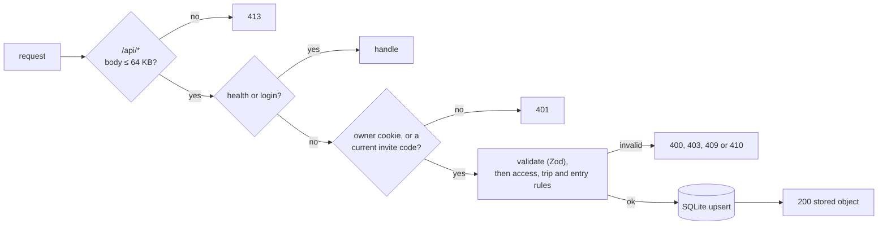

# API

The JSON API served by `src/server/` (routes are mounted in `app.ts`). The web app is its only client. For the data model and sync rules behind these endpoints, see [ARCHITECTURE.md](ARCHITECTURE.md).

## Conventions

- Request and response bodies are JSON. Request bodies are limited to 64 KB; a larger body gets 413. A body that is not JSON gets 400 `invalid JSON`.
- Every error response has the shape `{ "error": "<message>" }`. Validation errors name the first invalid field, for example `invalid entry.currency`.
- Each `/api/*` response sends `Cache-Control: no-store`.
- Every response, pages included, gets Hono's `secureHeaders` set (`X-Content-Type-Options: nosniff`, `X-Frame-Options: SAMEORIGIN`, `Referrer-Policy: no-referrer` and others). The server does not send `Strict-Transport-Security`. Set it at the HTTPS proxy.
- Amounts are integers in minor units; see [Money](ARCHITECTURE.md#money).
- The client creates ids and `updatedAt`. Writes are idempotent upserts: if a `PUT` has an `updatedAt` that is not newer than the stored one, the server keeps the stored object and returns it with 200.

## Auth

Every endpoint except `/api/health` and `/api/login` needs a session cookie. There are two kinds (see [Auth](ARCHITECTURE.md#auth)):

- `tb_session`: the owner. Sees and writes every trip, creates and deletes trips, and resets invite links.
- `tb_t_<tripId>`: a member of that trip, holding the trip's invite code. One cookie per joined trip. A member sees and writes only those trips.

A third cookie, `tb_device`, names the browser and grants nothing. The server sets it on the first `PUT /api/push/:tripId` and reads it to leave a device's own saves out of its notifications. It has the same attributes as the session cookies.

| Status | Meaning |
|---|---|
| 401 `login required` | The cookies grant nothing: no cookie, or every invite code was reset. The client shows the Login screen. |
| 403 | The session can't touch this trip: a member naming another trip, creating, deleting or restoring a trip, or resetting a link. The client keeps a rejected entry queued. |

If `APP_PASSCODE` is unset, auth is off and every request is the owner.



## Endpoints

| Method | Path | Auth | Purpose |
|---|---|---|---|
| any | `/api/health` | No | Liveness check, used by the Docker `HEALTHCHECK` |
| `POST` | `/api/login` | No | Exchange an invite code or the passcode for a session cookie |
| `GET` | `/api/state` | Yes | The live trips and entries this session can see, with their invite codes |
| `GET` | `/api/rates` | Yes | Latest exchange rates for those trips |
| `GET` | `/api/events` | Yes | A Server-Sent Events stream that names each trip as it changes |
| `PUT` | `/api/trips/:id` | Yes | Update a trip, or create, delete or restore one (owner only) |
| `POST` | `/api/trips/:id/travellers` | Yes | Add a traveller |
| `PATCH` | `/api/trips/:id/travellers` | Yes | Rename, remove or restore a traveller, or set their Swish number |
| `POST` | `/api/trips/:id/invite` | Owner | Reset the trip's invite link |
| `PUT` | `/api/entries/:id` | Yes | Create, update or delete an entry |
| `GET` | `/api/push/:tripId` | Yes | The push public key, and whether this device gets notifications for the trip |
| `PUT` | `/api/push/:tripId` | Yes | Turn on notifications for the trip on this device |
| `DELETE` | `/api/push/:tripId` | Yes | Turn them off |

### `GET|POST|… /api/health`

Returns `200 { "ok": true }`. Accepts any method.

### `POST /api/login`

```json
{ "code": "Q2xh4Rk0b9Vn1sZp7Yt3wA" }
```

`code` is a trip's invite code or the passcode, up to 200 characters. The server tries it as the code of a live trip first, then as the passcode. Cookies are `HttpOnly`, `SameSite=Lax`, one year, and `Secure` behind HTTPS.

| Status | Meaning |
|---|---|
| 200 | `{ "tripId": "k3j2" }` and `Set-Cookie: tb_t_k3j2=<code>`: joined that trip |
| 200 | `{ "tripId": null }` and `Set-Cookie: tb_session=…`: an owner session. When `APP_PASSCODE` is unset, every code that is not an invite code gets this answer. |
| 404 | `that link or code didn't work`. Not 401, so a signed-in member is not sent to the Login screen. |
| 429 | `too many attempts, wait 10 minutes`. There were 20 failed logins, from any client, within 10 minutes. |

### `GET /api/state`

Returns every trip and entry this session can see that is not deleted, and leaves out entries that belong to a deleted trip.

```json
{ "trips": [Trip], "entries": [Entry], "invites": { "k3j2": "Q2xh4Rk0b9Vn1sZp7Yt3wA" }, "owner": false }
```

- `invites` maps each listed trip to its current invite code.
- `owner` is `true` for an owner session. The client uses it only to hide owner actions; the server enforces them.
- `trips` are in creation order.
- `entries` are sorted by `date` (newest first), then by `updatedAt` (newest first).

### `GET /api/rates`

Returns the latest cached rate for each local currency of each live trip this session can see, grouped by home currency. A rate is in home units per 1 unit of the local currency. The server refreshes rates from frankfurter at most once an hour per pair. If frankfurter is unreachable, the server returns the cached rates instead.

```json
{ "SEK": { "KRW": 0.00747, "JPY": 0.0712 } }
```

A currency with no cached rate yet is left out.

### `GET /api/events`

A long-lived `text/event-stream` response. Each time a trip or one of its entries is saved, the server sends one event to every open stream whose session can see that trip:

```
event: change
data: k3j2
```

`data` is the trip id and nothing else. The client reacts by syncing. A stale or repeated write that the server ignores sends no event. Resetting an invite link also sends `change` for that trip, and then ends the stream of every member session, which must reconnect with the codes it still holds.

The stream opens with `retry: 15000`, so a client that loses the connection waits 15 seconds between reconnect attempts instead of the browser's default of about 3. Every 25 seconds the server sends a `: ping` comment to keep proxies from closing an idle stream. The response sets `X-Accel-Buffering: no`, so nginx passes events through without buffering.

| Status | Error |
|---|---|
| 401 | `login required` |

### `PUT /api/trips/:id`

The body is a full trip. The id in the path must match `id` in the body.

```json
{
  "id": "k3j2",
  "name": "Korea & Japan",
  "travellers": [{ "name": "Alex", "swish": "46701234567" }, { "name": "Sam" }],
  "home": "SEK",
  "locals": ["KRW", "JPY"],
  "budget": 4000000,
  "updatedAt": 1761206400000,
  "deleted": false
}
```

| Field | Rule |
|---|---|
| `name` | Trimmed, 1–80 characters |
| `travellers` | Up to 50 travellers, of whom 2–20 are not removed. Each has a `name` of 1–40 characters, not blank, an optional `removed: true`, and an optional `swish` number (`467` followed by 8 digits). A traveller's index is their permanent id. The server uses this field only when it creates the trip. On an existing trip it keeps the stored travellers and ignores the body's, so change them with the [traveller endpoints](#post-apitripsidtravellers). |
| `home`, `locals` | Three-letter uppercase codes, no duplicates across both, each published by the ECB |
| `budget` | Non-negative integer in home minor units, or `null` |
| `updatedAt` | Non-negative integer (ms since epoch) |
| `deleted` | `true` deletes the trip (tombstone) |

Returns 200 with the stored trip.

| Status | Error |
|---|---|
| 400 | `invalid trip.<field>`, or `No ECB exchange rates for XXX…`. A trip `id` is 1–64 letters, digits, `_` or `-`, because it becomes part of a cookie name. |
| 403 | `only the owner can create trips`: no trip with this id is stored. A tombstone counts as stored. |
| 403 | `not a member of this trip` |
| 403 | `only the owner can delete trips`: a member changed `deleted`, either way |
| 409 | `home currency is fixed once the trip has entries` |

### `POST /api/trips/:id/travellers`

Adds a traveller at the end of the list. The server picks the index, so two phones that add someone at the same time get two travellers.

```json
{ "name": "Kim" }
```

Returns 200 with the stored trip. The write does not change `updatedAt`, so it never wins or loses against a trip save. Each call sends a `change` event for the trip.

| Status | Error |
|---|---|
| 400 | `invalid traveller.name` |
| 403 | `not a member of this trip` |
| 404 | `trip not found`: unknown or deleted |
| 409 | `A trip can have at most 20 travellers.`: 20 are not removed |
| 409 | `This trip has used all its traveller slots.`: the list already holds 50, counting removed travellers |

### `PATCH /api/trips/:id/travellers`

Changes one traveller. Send `person` and at least one of the other fields.

```json
{ "person": 1, "name": "Samuel", "removed": false, "swish": "46701234567" }
```

| Field | Rule |
|---|---|
| `person` | Index into the trip's `travellers` |
| `name` | Optional. 1–40 characters, not blank. The Swish number stays. |
| `removed` | Optional. `true` removes the traveller and clears their Swish number. `false` restores them, without the number. |
| `swish` | Optional. `""` clears the number. Otherwise a Swedish mobile number in Swish link form, `467` followed by 8 digits. |

A traveller can be removed only when their balance over the trip's live entries is exactly zero and at least two others stay. The server checks the stored entries and writes in one step, with no `await` between. An entry already on its way can still land just after the removal, which the next sentences cover. A removed traveller keeps their index. Entries that name them are still accepted, and if their balance moves later they stay removed and can still be settled.

Returns 200 with the stored trip. Like adding, the write does not change `updatedAt`. A request that changes nothing returns the trip and sends no `change` event.

| Status | Error |
|---|---|
| 400 | `invalid traveller.<field>`. `invalid traveller.person` also means `person` is past the last traveller. |
| 403 | `not a member of this trip` |
| 404 | `trip not found`: unknown or deleted |
| 409 | `<name> still owes <amount>. Settle up first.` or `<name> is still owed <amount>. Settle up first.` |
| 409 | `A trip needs at least two travellers.` |
| 409 | `A trip can have at most 20 travellers.`: a restore would make 21 |
| 409 | `traveller is removed`: `swish` for a removed traveller |

### `PUT /api/entries/:id`

The body is an entry without `home`; the server calculates `home`. The id in the path must match `id` in the body.

```json
{
  "id": "e8f1",
  "tripId": "k3j2",
  "kind": "expense",
  "date": "2026-10-21",
  "title": "Bibimbap",
  "note": "Gwangjang market",
  "category": "food",
  "amount": 24000,
  "currency": "KRW",
  "rate": null,
  "rateManual": false,
  "paidBy": 0,
  "shares": [1, 1],
  "updatedAt": 1761206400000,
  "deleted": false
}
```

| Field | Rule |
|---|---|
| `kind` | `expense` or `transfer`. For a transfer, `paidBy` is the sender and `shares` gives weight only to the receiver. |
| `date` | `YYYY-MM-DD`. Used to look up the rate. |
| `title` | Up to 200 characters |
| `note` | Optional, up to 1000 characters. Leaving it out clears it. |
| `category` | One of `CATEGORIES` in `src/shared/types.ts` |
| `amount` | Positive integer, minor units of `currency` |
| `currency` | The trip's `home` currency or one of its `locals` |
| `rate` | `null` to let the server look it up, or a positive number to set it by hand. Always 1 for the home currency. |
| `paidBy` | Index into the trip's `travellers`. A removed traveller is allowed. |
| `shares` | 1 to 50 integer weights from 0 to 100, at least one above 0, no longer than the trip's `travellers` |
| `addedBy` | Optional. Index into the trip's `travellers` of who added the entry. A later write cannot change it. |
| `editedBy` | Optional. Index into the trip's `travellers` of who last edited the entry |
| `deleted` | `true` deletes the entry. A delete needs no rate lookup. |

Returns 200 with the stored entry, which includes `rate` and `home`.

| Status | Error |
|---|---|
| 400 | `invalid entry.<field>` |
| 403 | `not a member of this trip`: the body's `tripId`, or the trip of the stored entry with this id. Checked before the stale-write rule, so a stored entry is never returned to a non-member. |
| 409 | `an entry cannot move between trips` |
| 410 | `trip not found or deleted`. The client drops the entry from its outbox. |
| 502 | `rate unavailable: …`. Frankfurter failed, and no rate is cached for this currency pair. The client keeps the entry in its outbox and tries again later. |

### `POST /api/trips/:id/invite`

Owner only. Replaces the trip's invite code and returns `{ "code": "<new code>" }`. Every cookie holding the old code stops matching, so everyone who joined with the old link loses the trip until they open the new one. Their open `/api/events` streams get a last `change` for the trip and then end.

| Status | Error |
|---|---|
| 403 | `only the owner can reset invite links` |
| 404 | `trip not found`: unknown or deleted |

### `GET|PUT|DELETE /api/push/:tripId`

Web Push subscriptions for one trip on this device. The routes exist only when the server has VAPID keys (see the README). Without them every `/api/push/*` request gets 404 `not found`, and the client hides the Notifications card. All three answer 200 with:

```json
{ "key": "BDKGoBITmCq663xpmf7HauZup4Si…", "on": true }
```

- `key` is the VAPID public key the browser subscribes with. The server sends it at runtime because the Docker image builds the client once, without keys.
- `on` is `true` when this device's `tb_device` cookie has a subscription for the trip that is still valid. A member's subscription stops being valid when the trip's invite link is reset, and stays off after they rejoin until they turn it on again.

`PUT` takes the browser's `PushSubscription.toJSON()`:

```json
{ "endpoint": "https://fcm.googleapis.com/fcm/send/…", "keys": { "p256dh": "…", "auth": "…" } }
```

The server stores it under this device and trip, and sets `tb_device` if the request had none. Repeating the call is harmless. The same endpoint replaces the keys on all of the device's trips and is removed from any other device. `DELETE` removes this device's subscription for the trip; the browser keeps its subscription for other trips.

After a new expense or settle-up payment is saved, the server waits until no new one has arrived on that trip for 3 seconds, then sends one notification to each other subscribed device. The device that saved an entry is never told about it. Edits and deletes send nothing. A push service that answers 404 or 410 has dropped the subscription, so the server deletes it.

| Status | Error |
|---|---|
| 400 | `unsupported push service`: the endpoint is not `https`, or its host is not FCM, Mozilla, Apple or Windows push |
| 400 | `invalid subscription`: `keys` is missing or malformed |
| 403 | `not a member of this trip` |
| 404 | `trip not found`: `PUT` on an unknown or deleted trip |

## Everything else

| Request | Response |
|---|---|
| Unknown `/api/*` path | 404 `not found`, or 401 without a session |
| `GET /assets/*` | Built file, `Cache-Control: public, max-age=31536000, immutable` |
| Other `GET` with a file extension | The file if it exists (`no-cache`), otherwise 404 |
| Other `GET` without an extension | `index.html` (single-page app fallback), or 404 `not built: run pnpm build` |
| Any other method outside `/api` | 405 `method not allowed` |
