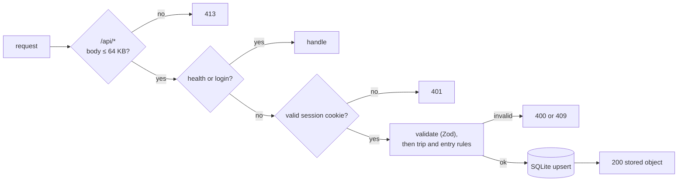

# API

The JSON API served by `src/server/main.ts`. The web app is its only client. For the data model and sync rules behind these endpoints, see [ARCHITECTURE.md](ARCHITECTURE.md).

## Conventions

- Request and response bodies are JSON. Request bodies are limited to 64 KB; a larger body gets 413.
- Every error response has the shape `{ "error": "<message>" }`. Validation errors name the first invalid field, for example `invalid entry.currency`.
- Each `/api/*` response sends `Cache-Control: no-store`.
- Amounts are integers in minor units; see [Money](ARCHITECTURE.md#money).
- The client creates ids and `updatedAt`. Writes are idempotent upserts: if a `PUT` has an `updatedAt` that is not newer than the stored one, the server keeps the stored object and returns it with 200.

## Auth

Every endpoint except `/api/health` and `/api/login` needs the `tb_session` cookie. Without a valid cookie, the server answers 401 `login required`. If `APP_PASSCODE` is unset, auth is off and every request is let through.



## Endpoints

| Method | Path | Auth | Purpose |
|---|---|---|---|
| any | `/api/health` | No | Liveness check, used by the Docker `HEALTHCHECK` |
| `POST` | `/api/login` | No | Exchange the passcode for a session cookie |
| `GET` | `/api/state` | Yes | All live trips and entries |
| `GET` | `/api/rates` | Yes | Latest exchange rates for every live trip |
| `PUT` | `/api/trips/:id` | Yes | Create, update or delete a trip |
| `PUT` | `/api/entries/:id` | Yes | Create, update or delete an entry |

### `GET|POST|… /api/health`

Returns `200 { "ok": true }`. Accepts any method.

### `POST /api/login`

```json
{ "passcode": "a-long-shared-passcode" }
```

| Status | Meaning |
|---|---|
| 200 | `{ "ok": true }` and a `Set-Cookie: tb_session=…` header (`HttpOnly`, `SameSite=Lax`, one year, `Secure` behind HTTPS) |
| 401 | `wrong passcode` |
| 429 | `too many attempts, wait 10 minutes`. There were 20 failed logins, from any client, within 10 minutes. |

### `GET /api/state`

Returns every trip and entry that is not deleted, and leaves out entries that belong to a deleted trip.

```json
{ "trips": [Trip], "entries": [Entry] }
```

- `trips` are in creation order.
- `entries` are sorted by `date` (newest first), then by `updatedAt` (newest first).

### `GET /api/rates`

Returns the latest cached rate for each local currency of each live trip, grouped by home currency. A rate is in home units per 1 unit of the local currency. The server refreshes rates from frankfurter at most once an hour per pair. If frankfurter is unreachable, the server returns the cached rates instead.

```json
{ "SEK": { "KRW": 0.00747, "JPY": 0.0712 } }
```

A currency with no cached rate yet is left out.

### `PUT /api/trips/:id`

The body is a full trip. The id in the path must match `id` in the body.

```json
{
  "id": "k3j2",
  "name": "Korea & Japan",
  "names": ["Alex", "Sam"],
  "home": "SEK",
  "locals": ["KRW", "JPY"],
  "budget": 4000000,
  "updatedAt": 1761206400000,
  "deleted": false
}
```

| Field | Rule |
|---|---|
| `name` | Trimmed, 1–80 characters |
| `names` | 2–20 travellers, each 1–40 characters and not blank |
| `home`, `locals` | Three-letter uppercase codes, no duplicates across both, each published by the ECB |
| `budget` | Non-negative integer in home minor units, or `null` |
| `updatedAt` | Non-negative integer (ms since epoch) |
| `deleted` | `true` deletes the trip (tombstone) |

Returns 200 with the stored trip.

| Status | Error |
|---|---|
| 400 | `invalid trip.<field>`, or `No ECB exchange rates for XXX…` |
| 409 | `home currency is fixed once the trip has entries` |
| 409 | `travellers cannot be removed once the trip has entries` |

### `PUT /api/entries/:id`

The body is an entry without `home`; the server calculates `home`. The id in the path must match `id` in the body.

```json
{
  "id": "e8f1",
  "tripId": "k3j2",
  "kind": "expense",
  "date": "2026-10-21",
  "title": "Bibimbap",
  "note": "Gwangjang market",
  "category": "food",
  "amount": 24000,
  "currency": "KRW",
  "rate": null,
  "rateManual": false,
  "paidBy": 0,
  "shares": [1, 1],
  "updatedAt": 1761206400000,
  "deleted": false
}
```

| Field | Rule |
|---|---|
| `kind` | `expense` or `transfer`. For a transfer, `paidBy` is the sender and `shares` gives weight only to the receiver. |
| `date` | `YYYY-MM-DD`. Used to look up the rate. |
| `title` | Up to 200 characters |
| `note` | Optional, up to 1000 characters. Leaving it out clears it. |
| `category` | One of `CATEGORIES` in `src/shared/types.ts` |
| `amount` | Positive integer, minor units of `currency` |
| `currency` | The trip's `home` currency or one of its `locals` |
| `rate` | `null` to let the server look it up, or a positive number to set it by hand. Always 1 for the home currency. |
| `paidBy` | Index into the trip's `names` |
| `shares` | 1 to 20 integer weights from 0 to 100, at least one above 0, no longer than the trip's `names` |
| `deleted` | `true` deletes the entry. A delete needs no rate lookup. |

Returns 200 with the stored entry, which includes `rate` and `home`.

| Status | Error |
|---|---|
| 400 | `invalid entry.<field>` |
| 409 | `trip not found or deleted` |
| 409 | `an entry cannot move between trips` |
| 502 | `rate unavailable: …`. Frankfurter failed, and no rate is cached for this currency pair. The client keeps the entry in its outbox and tries again later. |

## Everything else

| Request | Response |
|---|---|
| Unknown `/api/*` path | 404 `not found` |
| `GET /assets/*` | Built file, `Cache-Control: public, max-age=31536000, immutable` |
| Other `GET` with a file extension | The file if it exists (`no-cache`), otherwise 404 |
| Other `GET` without an extension | `index.html` (single-page app fallback), or 404 `not built: run pnpm build` |
| Any other method outside `/api` | 405 `method not allowed` |
