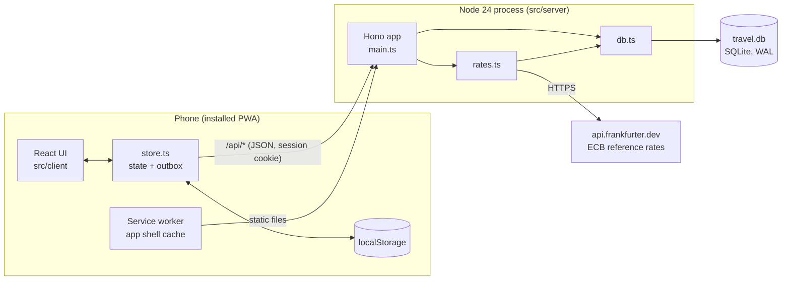
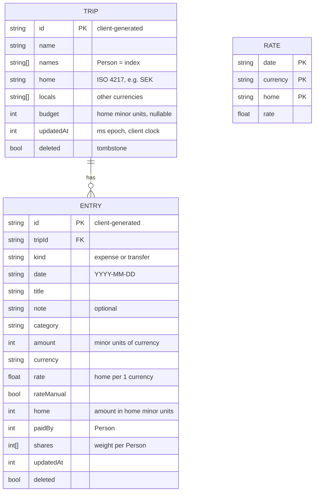
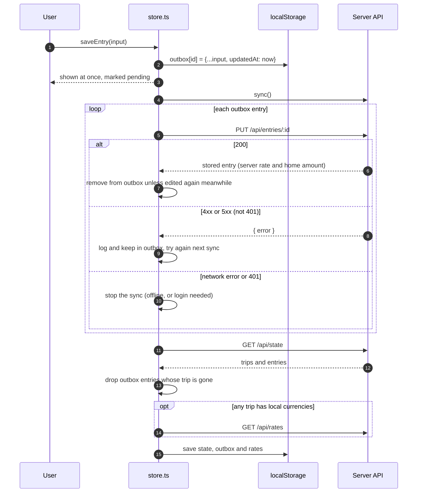
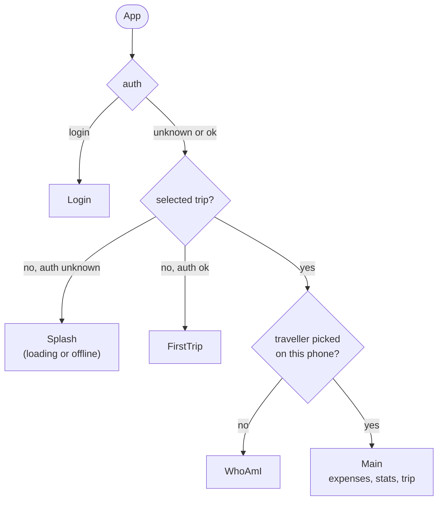
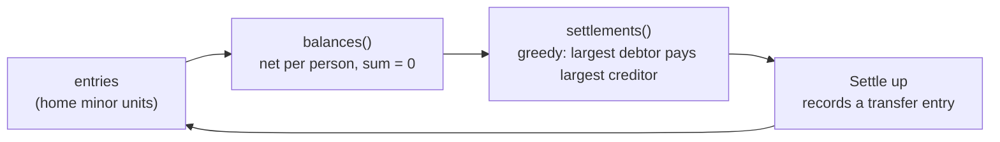
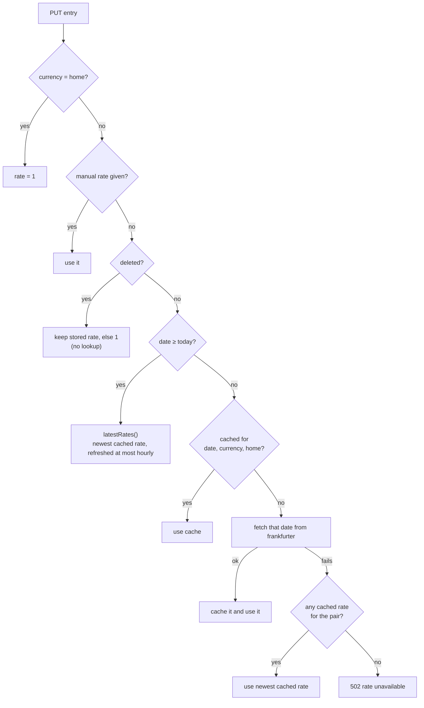

# Architecture

How Trip Split works inside: where the code lives, how data is stored, how offline entries reach the server, and how money and exchange rates are calculated. For running and deploying, see the [README](../README.md). For the HTTP endpoints, see [API.md](API.md).

## Overview

Trip Split is one Node 24 process. It serves the built React app and a small JSON API, and it stores everything in one SQLite file. The phone keeps a copy of the state and an outbox of unsent entries in `localStorage`, so you can add expenses without a connection.

## Code layout

| Path | Runs on | Contents |
|---|---|---|
| `src/shared/` | Both | `schema.ts` (Zod schemas), `types.ts` (types derived from them), `ledger.ts` (money math, balances, settlements, stats) |
| `src/server/` | Node | `main.ts` (HTTP app, auth, validation), `db.ts` (SQLite), `rates.ts` (exchange rates) |
| `src/client/lib/` | Browser | `store.ts` (state, outbox, sync), `format.ts`, `csv.ts`, `labels.ts` |
| `src/client/` other folders | Browser | React components, grouped by screen: `expenses/`, `trips/`, `stats/`, `gates/`, `ui/` |

The server runs from TypeScript source with Node's built-in type stripping, so there is no server build step. That is why `tsconfig.json` sets `erasableSyntaxOnly`. Vite builds only the client, into `dist/`.

## Data model

A **trip** has an ordered list of traveller names, a home currency, zero or more local currencies and an optional budget. An **entry** is either an expense or a transfer and belongs to one trip. A traveller is not a separate record: a `Person` is an index into `trip.names`.

### Storage

Each SQLite table keeps the whole validated object as JSON in a `json` column. The other columns are copies of the fields that SQL needs for lookups, ordering and conflict checks:

| Table | Columns | Why the extra columns exist |
|---|---|---|
| `trips` | `id`, `updated_at`, `json` | Last-write-wins check |
| `entries` | `id`, `trip_id`, `date`, `updated_at`, `json` | Last-write-wins check, ordering by date, index on `trip_id` |
| `rates` | `date`, `currency`, `home`, `rate` | Exchange rate cache, one row per day and currency pair |

Queries filter out deleted rows with `json ->> 'deleted' = 0`. Trips are listed by `rowid`, which is creation order, because an upsert keeps the `rowid`.

### Deletes are tombstones

Nothing is ever removed from the database. A delete is a normal write with `deleted: true`. The tombstone has a newer `updatedAt`, so a stale write from another phone cannot bring the item back. A deleted trip also hides all of its entries from `/api/state`.

### Rules the server enforces

Zod checks the shape of every write (`src/shared/schema.ts`). `main.ts` then checks these rules, which need the stored data:

| Rule | Status code |
|---|---|
| The URL id and the body `id` must match | 400 |
| An entry's trip must exist and must not be deleted | 409 |
| An entry's currency must be the trip's home currency or one of its local currencies | 400 |
| `paidBy` and the `shares` array must fit the trip's traveller list | 400 |
| An entry cannot move to a different trip | 409 |
| A trip's home currency cannot change after the trip has entries | 409 |
| Travellers can be added at any time, but removed only while the trip has no entries | 409 |
| New trip currencies must be published by the ECB | 400 |

Removing travellers is blocked because entries refer to people by index. Removing one would shift everyone after them.

## Sync and offline

The server resolves conflicts with **last-write-wins on `updatedAt`**. The client sets `updatedAt` to `Date.now()` on every save. The server applies a write only when its `updatedAt` is newer than the stored one, all in one SQL statement (`INSERT … ON CONFLICT … WHERE excluded.updated_at > updated_at`), so two concurrent requests cannot interleave. A stale or repeated write gets the stored object back with status 200, so retries are safe.

Entries can be saved offline. Trips can't: `saveTrip` calls the API directly, and the trip form shows an error when there is no connection.

### The outbox

`store.ts` keeps two collections in `localStorage`:

- `server`: the last `/api/state` response.
- `outbox`: entries saved on this phone that the server has not confirmed yet, keyed by id.

The view merges the two, and outbox entries take priority. Outbox ids are shown as pending in the UI. Until the server prices an outbox entry, the phone estimates its home amount, using the first available rate from this list:

1. The rate typed in by hand.
2. The latest cached rate for that currency.
3. The rate already stored for the entry.
4. Zero.

The server always computes the final rate.

Only one sync runs at a time. A call made while a sync is running waits for that sync. A sync starts when:

- the app starts,
- you save an entry,
- you save a trip,
- you log in,
- the browser comes back online,
- the app becomes visible again,
- 60 seconds pass.

An entry that the server rejects with a 4xx or 5xx stays in the outbox and is sent again on every sync. Nothing is dropped without confirmation. Check the console for `Rejected entry` when an entry stays pending.

### Service worker

`vite-plugin-pwa` builds `sw.js`. It precaches the app shell: HTML, JS, CSS, fonts and icons. Page navigations are network-first with a 3-second timeout, and fall back to the cached `index.html`. API responses are never cached, because the server sends `Cache-Control: no-store`. `localStorage` holds the offline data, not the service worker.

### Client state in `localStorage`

| Key | Contents |
|---|---|
| `tb:state2` | Last server state (`{ trips, entries }`) |
| `tb:outbox2` | Unconfirmed entries, keyed by id |
| `tb:rates2` | Latest rates (`{ [home]: { [currency]: rate } }`) |
| `tb:me2` | Which traveller this phone is, per trip id |
| `tb:trip` | Selected trip id |
| `tb:lastCurrency` | Default currency for the next expense |

The `2` suffix marks a format change. Bump the suffix when a stored format changes incompatibly, so old data is ignored instead of misread.

### Screen gates

`App.tsx` shows the first screen whose condition is not met yet:

## Money

All amounts are **integers in minor units** of their own currency. The number of decimals comes from `Intl.NumberFormat`: 0 for KRW and JPY, 2 for SEK and EUR. Floats are used only for exchange rates.

| Field | Unit |
|---|---|
| `entry.amount` | Minor units of `entry.currency` |
| `entry.rate` | Home currency (major units) per 1 unit of `entry.currency` (major units) |
| `entry.home` | Minor units of the trip's home currency: `round(major(amount) × rate)` |
| `trip.budget` | Minor units of the home currency |

The server calculates `home` when it saves an entry and stores the result. Balances and stats add up these stored integers and never convert again, so a total doesn't change when rates change later.

### Splitting

`shares` holds one integer weight per traveller. Even split is all 1s; 2:1:1 is `[2, 1, 1]`; leaving someone out is a 0. The array can be shorter than `names`, and missing trailing weights count as 0. That is how older entries keep working after a traveller joins.

`allocate(total, weights)` uses the largest-remainder method. Each person gets the floor of their exact share. The leftover minor units then go one at a time to the largest fractional parts, with ties going to the lower index. The parts always add up exactly to `total`.

### Balances and settling up

For each entry that is not deleted, `balances()` adds `home` to the payer and subtracts each person's allocated share. A positive balance means the others owe you. The balances of a trip always add up to zero.

A **transfer** is an entry with `kind: 'transfer'`. `paidBy` is the sender, and `shares` gives weight 1 only to the receiver (`transferShares(to)`). Transfers count in balances, but `summarize()` leaves them out of the stats, because no money was spent.

`settlements()` pairs the largest debtor with the largest creditor. It records a payment of the smaller of the two amounts, then repeats. Each payment brings at least one person to zero, so a group of *n* people needs at most *n − 1* payments. This is a greedy method: usually it finds the fewest payments, but not always.

## Exchange rates

Rates are ECB daily reference rates from [frankfurter.dev](https://frankfurter.dev), which needs no API key. `rates.ts` requests them with `base=home` and inverts the result, because a direct KRW→SEK quote has too few significant digits.

The server sets an entry's rate like this:

- **Past dates** are cached forever, because ECB rates for a past day don't change.
- **Today and future dates** use the latest rate. It is fetched at most once an hour per currency pair; the timer is kept in memory, so it resets when the server restarts. Today's rate may not be published yet.
- **`GET /api/rates`** returns the latest rate for every local currency of every live trip, grouped by home currency. The client uses these rates to estimate offline entries.
- **Currency check:** when a trip is created, or gets a new home or local currency, the server checks that frankfurter publishes those currencies. The currency list is fetched once per process. If frankfurter is down, the check is skipped instead of blocking the save.

## Auth

The app has one shared passcode, set in `APP_PASSCODE`. `POST /api/login` compares HMAC digests in constant time. On success it sets the `tb_session` cookie: `httpOnly`, `SameSite=Lax`, valid for one year, and `Secure` when `X-Forwarded-Proto` is `https`. The cookie value is an HMAC of a fixed string, keyed with the passcode. It is not stored anywhere, so changing the passcode logs out every phone.

Failed logins count globally, not per IP, because client IPs are unreliable behind a proxy. After 20 failures within 10 minutes, the server answers 429 until older failures expire. When `APP_PASSCODE` is unset, the server logs a warning and skips auth.

## Tests

| File | What it covers |
|---|---|
| `src/server/api.test.ts` | The real server, started on a random port with a temporary data directory. `fetch` to frankfurter is stubbed. |
| `src/client/lib/store.test.ts` | The client store and outbox, syncing against a real server |
| `src/shared/ledger.test.ts` | Rounding, allocation, balances, settlements |
| `src/client/lib/*.test.ts` | Formatting and CSV export |

Run them with `pnpm test`.
