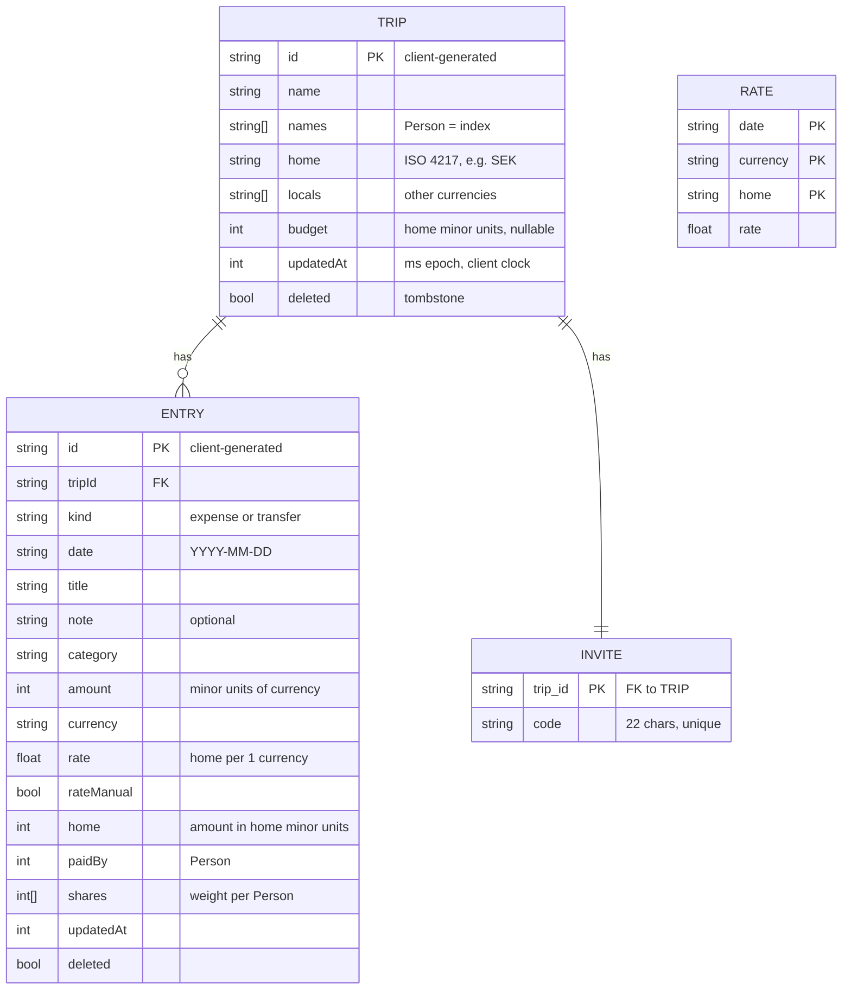
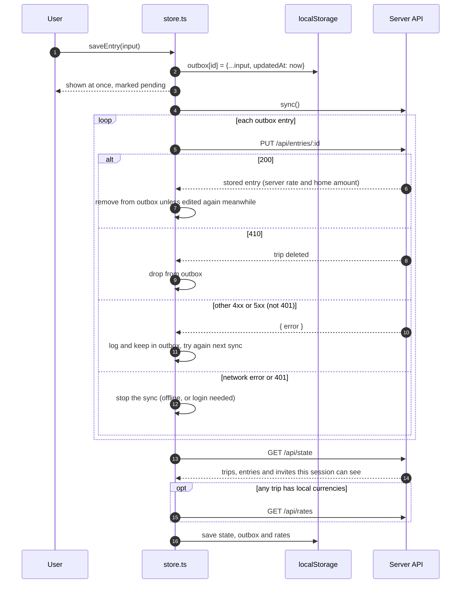
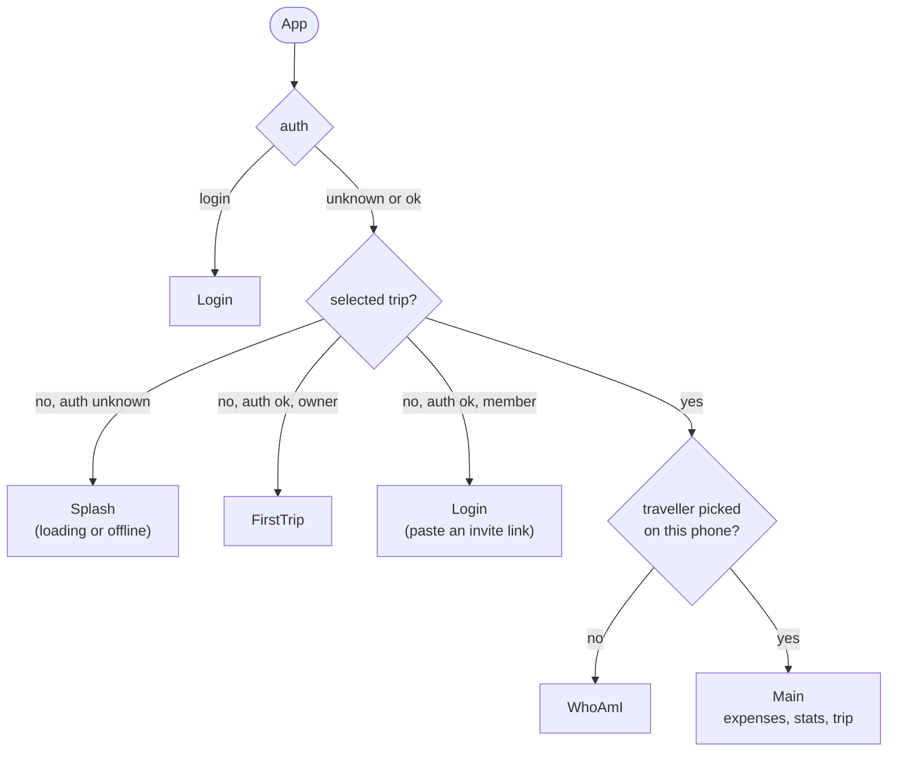
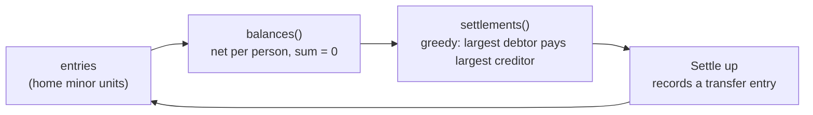
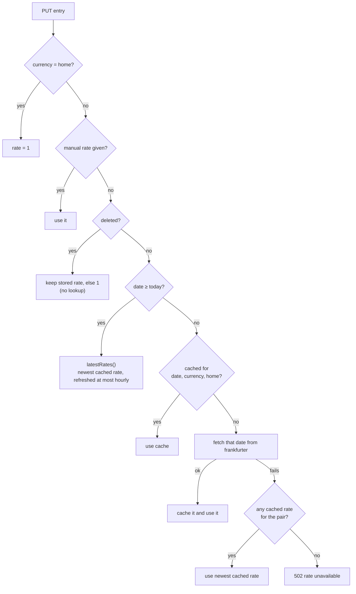
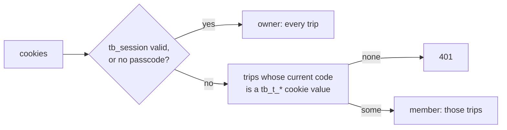

# Architecture

How Trip Split works inside: where the code lives, how data is stored, how offline entries reach the server, and how money and exchange rates are calculated. For running and deploying, see the [README](../README.md). For the HTTP endpoints, see [API.md](API.md).

## Overview

Trip Split is one Node 24 process. It serves the built React app and a small JSON API, and it stores everything in one SQLite file. The phone keeps a copy of the state and an outbox of unsent entries in `localStorage`, so you can add expenses without a connection.

## Code layout

| Path | Runs on | Contents |
|---|---|---|
| `src/shared/` | Both | `schema.ts` (Zod schemas), `types.ts` (types derived from them), `ledger.ts` (money math, balances, settlements, stats) |
| `src/server/` | Node | `main.ts` (startup and shutdown), `app.ts` (middleware and route mounting), `access.ts` (login and the access gate), `trips.ts` and `entries.ts` (write rules), `state.ts` (state and rates reads), `events.ts` (SSE), `push.ts` (Web Push), `static.ts` (the built web app), `db.ts` (SQLite), `rates.ts` (exchange rates) |
| `src/client/lib/` | Browser | `store.ts` (state, outbox, sync), `api.ts` (fetch and `HttpError`), `push.ts` (browser push subscription), `storage.ts` (`localStorage` keys), `format.ts`, `csv.ts`, `labels.ts` |
| `public/push-sw.js` | Service worker | Push and notification-click handlers, imported by the generated `sw.js` |
| `src/client/` other folders | Browser | React components, grouped by screen: `expenses/`, `trips/`, `stats/`, `gates/`, `ui/` |

The server runs from TypeScript source with Node's built-in type stripping, so there is no server build step. That is why `tsconfig.json` sets `erasableSyntaxOnly`. Vite builds only the client, into `dist/`.

## Data model

A **trip** has an ordered list of traveller names, a home currency, zero or more local currencies and an optional budget. An **entry** is either an expense or a transfer and belongs to one trip. A traveller is not a separate record: a `Person` is an index into `trip.names`.

### Storage

For the full schema, backups and schema changes, see [DATABASE.md](DATABASE.md).

Each SQLite table keeps the whole validated object as JSON in a `json` column. The other columns are copies of the fields that SQL needs for lookups, ordering and conflict checks:

| Table | Columns | Why the extra columns exist |
|---|---|---|
| `trips` | `id`, `updated_at`, `json` | Last-write-wins check |
| `entries` | `id`, `trip_id`, `date`, `updated_at`, `json` | Last-write-wins check, ordering by date, index on `trip_id` |
| `rates` | `date`, `currency`, `home`, `rate` | Exchange rate cache, one row per day and currency pair |
| `invites` | `trip_id`, `code` | Each trip's current invite code (see [Auth](#auth)). Kept out of `trips.json`, so `/api/state` serves a code only to sessions that can see its trip. |

Queries filter out deleted rows with `json ->> 'deleted' = 0`. Trips are listed by `rowid`, which is creation order, because an upsert keeps the `rowid`.

### Deletes are tombstones

Nothing is ever removed from the database. A delete is a normal write with `deleted: true`. The tombstone has a newer `updatedAt`, so a stale write from another phone cannot bring the item back. A deleted trip also hides all of its entries from `/api/state`.

### Rules the server enforces

Zod checks the shape of every write (`src/shared/schema.ts`). `trips.ts` and `entries.ts` then check these rules, which need the stored data:

| Rule | Status code |
|---|---|
| The URL id and the body `id` must match | 400 |
| The session must be allowed to see the entry's trip, and the trip of the stored entry with that id | 403 |
| Only the owner can create, delete or restore a trip, and a member can update only their trips | 403 |
| An entry's trip must exist and must not be deleted | 410 |
| An entry's currency must be the trip's home currency or one of its local currencies | 400 |
| `paidBy` and the `shares` array must fit the trip's traveller list | 400 |
| An entry cannot move to a different trip | 409 |
| A trip's home currency cannot change after the trip has entries | 409 |
| Travellers can be added at any time, but removed only while the trip has no entries | 409 |
| New trip currencies must be published by the ECB | 400 |

Removing travellers is blocked because entries refer to people by index. Removing one would shift everyone after them.

## Sync and offline

The server resolves conflicts with **last-write-wins on `updatedAt`**. The client sets `updatedAt` to `Date.now()` on every save. The server applies a write only when its `updatedAt` is newer than the stored one, all in one SQL statement (`INSERT … ON CONFLICT … WHERE excluded.updated_at > updated_at`), so two concurrent requests cannot interleave. A stale or repeated write gets the stored object back with status 200, so retries are safe.

Entries can be saved offline. Trips can't: `saveTrip` calls the API directly, and the trip form shows an error when there is no connection.

### The outbox

`store.ts` keeps two collections in `localStorage`:

- `server`: the last `/api/state` response.
- `outbox`: entries saved on this phone that the server has not confirmed yet, keyed by id.

The view merges the two, and outbox entries take priority. Outbox ids are shown as pending in the UI. Until the server prices an outbox entry, the phone estimates its home amount, using the first available rate from this list:

1. The rate typed in by hand.
2. The latest cached rate for that currency.
3. The rate already stored for the entry.
4. Zero.

The server always computes the final rate.

Only one sync runs at a time. A call made while a sync is running waits for that sync. A sync starts when:

- the app starts,
- you save an entry,
- you save a trip,
- you log in,
- the browser comes back online,
- the app becomes visible again,
- the server reports a change to a trip (see [Live updates](#live-updates)),
- 60 seconds pass.

An entry that the server rejects with a 4xx or 5xx stays in the outbox and is sent again on every sync. The one exception is 410, which means its trip is deleted for good. A trip missing from `/api/state` is not treated as deleted, because a member who lost access (for example after a link reset) sees fewer trips. Their entries stay queued, are left out of the pending count, and sync once the phone rejoins. Check the console for `Rejected entry` when an entry stays pending.

### Live updates

After each successful sync, the client keeps one `EventSource` open on `GET /api/events`. When anyone saves a trip or an entry, the server sends `change` with the trip id to every stream whose session can see that trip, and each of those clients runs a normal sync.

The stream carries no trip or entry data. It is only a nudge. All data still arrives through `/api/state`, so there is one merge path, and the access rules live in one place.

`EventSource` reconnects by itself after a network drop, and the client syncs on every `open` to catch up on what it missed. A 401 or an error status closes the stream for good. The next sync opens a new one, so coming back online, returning to the app, or the 60-second timer revives it. The server works out a stream's trips once, when it opens, so a successful login closes the stream and the sync after it opens one that covers the newly joined trip. The 60-second sync stays as a fallback for a stream that a proxy holds open but no longer delivers.

### Push notifications

Live updates reach only an open app. Web Push reaches a phone with the app closed. It is off unless the server has the three `VAPID_*` variables; then `src/server/push.ts` serves `/api/push/:tripId` and the Trip tab shows a **Notifications** card. The server sends pushes itself with the `web-push` package. No third-party service holds the subscriptions.

- **Trigger.** `entryRoutes` calls `push.created` when a write creates a live entry: an expense or a settle-up payment. `db.putEntry` decides "created" from the row it read just before the upsert, with no `await` in between, so a retry, an edit, a delete, a tombstone for an entry the server never saw, or a write that loses the last-write-wins race announces nothing. `events.notify` is the wrong hook, because it also fires for edits, deletes, trip saves and link resets.
- **Coalescing.** Each trip has one pending burst of entry ids. Every new entry restarts its 3-second timer, so an outbox flush of several entries, a few hundred milliseconds apart, becomes one notification. When the timer fires, the server re-reads the trip and the entries, so an entry deleted within the window is dropped and a deleted trip sends nothing. A notification shows up to three lines (`Ada paid 45 000 KRW for Dinner`, `Ada paid Bo 300 SEK`) and then `+N more`. Amounts use the currency code, because `money()` is client code and is not in the Docker image.
- **Exclusion.** A device is a browser profile, named by the `tb_device` cookie that the first subscribe sets. Each burst remembers which device saved each entry, and each recipient gets only the entries another device saved. A device with nothing left gets no notification. The client sends nothing extra: the cookie rides on the entry `PUT` it already makes.
- **Revocation.** A member's push row stores the invite code their cookie held when they subscribed. Reads keep a row only if that code is still the trip's code, so a link reset turns off every member's notifications without touching the `push` table, and a subscribe racing a reset cannot store a grant that outlives it. Owner rows store no code.
- **Cleanup.** A push service that answers 404 or 410 has dropped the subscription, so the server deletes every row with that endpoint. Other failures are logged with the push service's host only and the row stays.

On the client, `lib/push.ts` asks for permission as the first `await` of the tap, because iOS shows the prompt only inside the user gesture, then subscribes through the service worker and sends `PushSubscription.toJSON()`. Turning notifications off deletes the server row and keeps the browser subscription, which other trips may use. The card renders nothing when the server has push off. In a browser without push support, which includes Safari outside the home-screen app and `pnpm dev`, it shows how to install the app instead.

Known limits:

- Owner subscriptions survive an `APP_PASSCODE` change.
- A browser that clears its cookies but keeps its push subscription gets notified of its own saves until it turns notifications on again.
- Bursts still waiting when the server shuts down are lost.
- `pushsubscriptionchange` is not handled. A subscription the browser rotates stops working until the user turns notifications on again.
- After a VAPID key change, old subscriptions fail with a status other than 404 or 410. The server logs those failures and keeps the rows.

### Service worker

`vite-plugin-pwa` builds `sw.js`. It precaches the app shell: HTML, JS, CSS, fonts and icons. Page navigations, except under `/api/`, get the precached `index.html` without waiting for the network, so a launch on a weak connection is as fast as one on wifi. The worker checks for a new `sw.js` on each launch and takes over as soon as it installs, but the page that is already open keeps the old bundle, so a deploy shows up on the launch after that. API responses are never cached, because the server sends `Cache-Control: no-store`. `localStorage` holds the offline data, not the service worker.

The generated `sw.js` also loads `public/push-sw.js` through Workbox's `importScripts`. That file is plain JavaScript and is not type-checked. It shows a notification for every push, since iOS revokes a subscription whose push shows nothing. A tap on a notification focuses an open window and navigates it to `/?trip=<id>`, or opens a new one. `boot()` in `store.ts` selects that trip and removes the query from the URL. There is no service worker in `pnpm dev`, so push only works in a production build.

### Client state in `localStorage`

| Key | Contents |
|---|---|
| `tb:state2` | Last server state (`{ trips, entries, invites, owner }`). A cache from before invites loads with `invites: {}` and `owner: false` until the next sync. |
| `tb:outbox2` | Unconfirmed entries, keyed by id |
| `tb:rates2` | Latest rates (`{ [home]: { [currency]: rate } }`) |
| `tb:me2` | Which traveller this phone is, per trip id |
| `tb:trip` | Selected trip id |
| `tb:lastCurrency` | Default currency for the next expense |

The `2` suffix marks a format change. Bump the suffix when a stored format changes incompatibly, so old data is ignored instead of misread.

### Screen gates

`App.tsx` shows the first screen whose condition is not met yet:

## Money

All amounts are **integers in minor units** of their own currency. The number of decimals comes from `Intl.NumberFormat`: 0 for KRW and JPY, 2 for SEK and EUR. Floats are used only for exchange rates.

| Field | Unit |
|---|---|
| `entry.amount` | Minor units of `entry.currency` |
| `entry.rate` | Home currency (major units) per 1 unit of `entry.currency` (major units) |
| `entry.home` | Minor units of the trip's home currency: `round(major(amount) × rate)` |
| `trip.budget` | Minor units of the home currency |

The server calculates `home` when it saves an entry and stores the result. Balances and stats add up these stored integers and never convert again, so a total doesn't change when rates change later.

### Splitting

`shares` holds one integer weight per traveller. Even split is all 1s; 2:1:1 is `[2, 1, 1]`; leaving someone out is a 0. The array can be shorter than `names`, and missing trailing weights count as 0. That is how older entries keep working after a traveller joins.

`allocate(total, weights)` uses the largest-remainder method. Each person gets the floor of their exact share. The leftover minor units then go one at a time to the largest fractional parts, with ties going to the lower index. The parts always add up exactly to `total`.

### Balances and settling up

For each entry that is not deleted, `balances()` adds `home` to the payer and subtracts each person's allocated share. A positive balance means the others owe you. The balances of a trip always add up to zero.

A **transfer** is an entry with `kind: 'transfer'`. `paidBy` is the sender, and `shares` gives weight 1 only to the receiver (`transferShares(to)`). Transfers count in balances, but `summarize()` leaves them out of the stats, because no money was spent.

`settlements()` pairs the largest debtor with the largest creditor. It records a payment of the smaller of the two amounts, then repeats. Each payment brings at least one person to zero, so a group of *n* people needs at most *n − 1* payments. This is a greedy method: usually it finds the fewest payments, but not always.

## Exchange rates

Rates are ECB daily reference rates from [frankfurter.dev](https://frankfurter.dev), which needs no API key. `rates.ts` requests them with `base=home` and inverts the result, because a direct KRW→SEK quote has too few significant digits.

The server sets an entry's rate like this:

- **Past dates** are cached forever, because ECB rates for a past day don't change.
- **Today and future dates** use the latest rate. It is fetched at most once an hour per currency pair; the timer is kept in memory, so it resets when the server restarts. Today's rate may not be published yet.
- **`GET /api/rates`** returns the latest rate for every local currency of every live trip the session can see, grouped by home currency. The client uses these rates to estimate offline entries.
- **Currency check:** when a trip is created, or gets a new home or local currency, the server checks that frankfurter publishes those currencies. The currency list is fetched once per process. If frankfurter is down, the check is skipped instead of blocking the save.

## Auth

There are two kinds of session. The **owner** knows `APP_PASSCODE` and sees every trip. Only the owner can create and delete trips and reset invite links. A **member** joined through a trip's invite link and sees only the trips they joined. Members can read and write those trips, including their entries, travellers and the trip's settings, but cannot delete or restore the trip.

Each trip has one invite code: 16 random bytes in base64url (22 characters), in the `invites` table. Every trip, deleted ones included, has a row. `openDb` backfills codes for trips that predate invites, and `db.putTrip` adds one for each new trip. Rows are never deleted. The invite link is `https://<host>/#join=<code>`. The code sits in the URL fragment, so it never reaches the server's logs, the `Referer` header or the service worker's page cache.

`POST /api/login` is the only way in, and the Login screen has one field for a pasted link, a bare code or the passcode. The server first looks the value up as the code of a live trip. On a match it sets the cookie `tb_t_<tripId>=<code>`. Otherwise it compares the value with the passcode as HMAC digests in constant time, and on a match it sets `tb_session`. That cookie is an HMAC of a fixed string, keyed with the passcode, so owner sessions survive a server restart, and changing the passcode logs out every owner. Every cookie is `httpOnly`, `SameSite=Lax`, valid for one year, and `Secure` when `X-Forwarded-Proto` is `https`.

Membership is not stored. On every `/api/*` request the gate in `access.ts` reads the values of all `tb_t_*` cookies, looks them up in `invites`, and resolves the request to an `Access`, either `{ owner: true }` or `{ owner: false, trips }`. Routes check it only through `can`, `need` (403) and `ownerOnly` (403). The gate answers 401 only when the cookies grant nothing at all, because the client shows the Login screen on any 401. Resetting a link (`POST /api/trips/:id/invite`) replaces the code, so cookies holding the old code stop matching. Everyone who joined with it loses the trip on their next request and needs the new link.

Failed logins count globally, not per IP, because client IPs are unreliable behind a proxy. A wrong code or passcode gets 404, not 401, so a member who pastes a bad second link is not sent to the Login screen. After 20 failures within 10 minutes, the server answers 429 until older failures expire, for codes and the passcode alike. When `APP_PASSCODE` is unset, the server logs a warning and treats every request as the owner.

The `tb_device` cookie is identity, not access. It is a random id set on the first push subscribe, the gate never reads it, and it grants nothing. See [Push notifications](#push-notifications).

A home-screen app on iOS keeps its own cookies, separate from Safari's. A link opened in Safari therefore does not sign in the installed app, so the app's Login screen and the **Join a trip** row in the trips sheet accept a pasted link.

## Tests

| File | What it covers |
|---|---|
| `src/server/api.test.ts` | The real server, started on a random port with a temporary data directory. `fetch` to frankfurter is stubbed. Push tests start a second server with a fake sender passed as `start({ push })`, because `web-push` does not use `fetch`, and assert on the payloads it receives. |
| `src/client/lib/store.test.ts` | The client store and outbox, syncing against a real server |
| `src/shared/ledger.test.ts` | Rounding, allocation, balances, settlements |
| `src/client/lib/*.test.ts` | Formatting and CSV export |

Run them with `pnpm test`.
